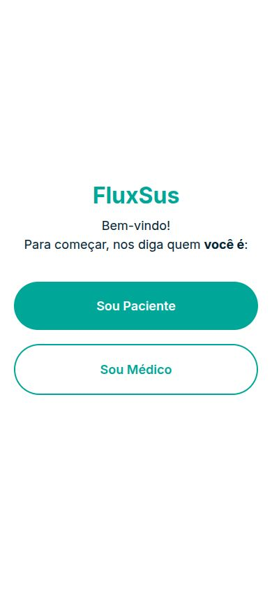
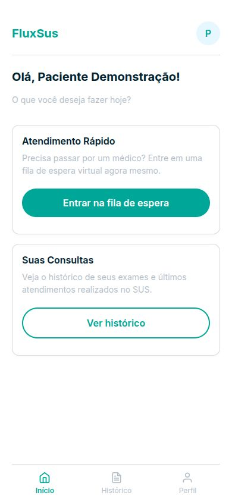
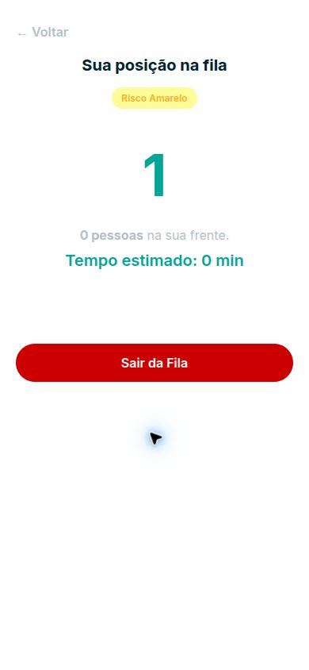
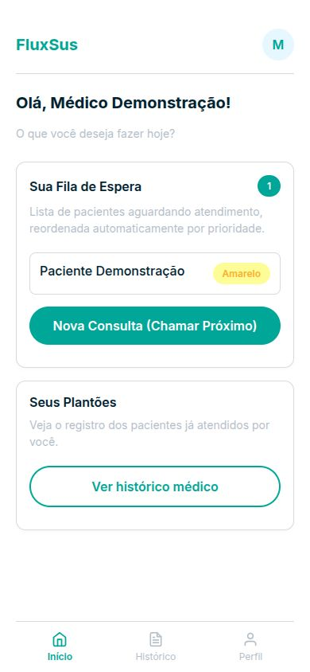
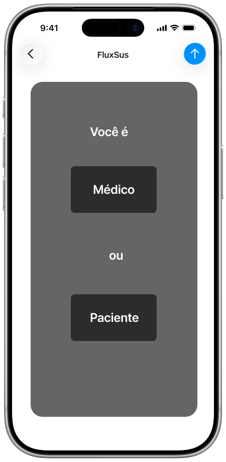
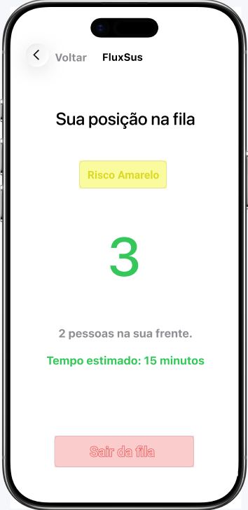
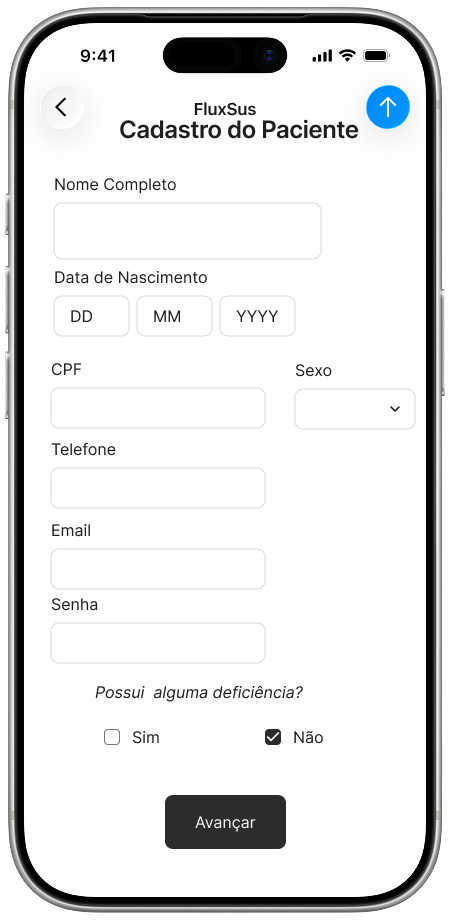
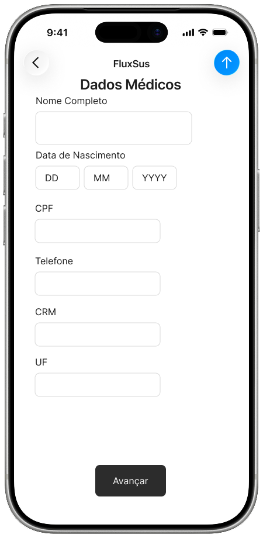
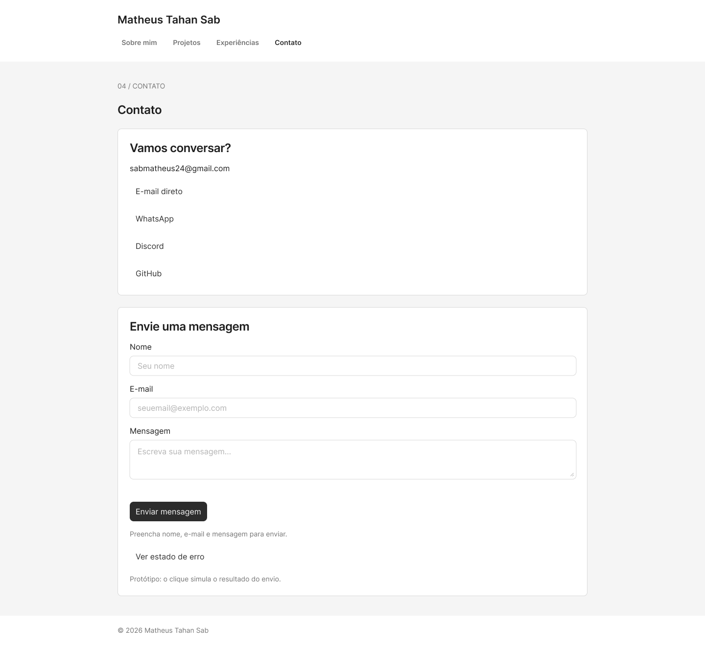
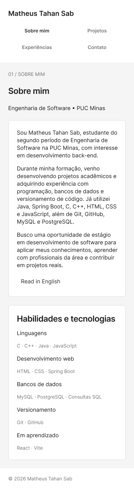

# Matheus Tahan Sab — Portfólio

Portfólio profissional desenvolvido para o Laboratório 01 de Desenvolvimento e Integração de Aplicações Web. O projeto apresenta formação, projetos, experiências e formas de contato.

## Prévia visual — Pokédex retrô

Esta branch `feat/pokedex-retro` contém uma proposta de interface inspirada em aparelhos e jogos retrô: paleta vermelha e creme, painéis verdes, tipografia pixelada, avatar vetorial original e navegação numerada. O conteúdo acadêmico e as capturas do FluxSUS foram mantidos.

O endereço de produção continua usando a branch `main`. Esta proposta deve ser avaliada pela prévia da Vercel ou por execução local antes de integrar à versão principal. Veja [decisões e verificações](docs/pokedex-retro.md).

## Status do projeto

Front-end em React + Vite publicado na Vercel e API de contato em Java 17 + Spring Boot publicada no Render. O formulário envia e-mails pelo Resend via HTTPS, com recebimento real confirmado em 12/10/2026. O conteúdo do FluxSUS, experiência acadêmica e links de contato já estão cadastrados. Os wireframes de média fidelidade estão disponíveis no Figma. O portfólio inclui wireframes e quatro capturas reais do FluxSUS em execução local com dados fictícios. Nesta branch, o modo claro mantém a Pokédex original e o modo escuro usa a paleta da Ultra Ball, com preferência salva no navegador.

## Links úteis

- [Repositório](https://github.com/Matheus-Tahan-Sab/MatheusTahanSab---portfolio)
- [Site publicado](https://matheus-tahan-sab-portfolio.vercel.app)
- [API de contato](https://matheus-tahan-sab-portfolio-api.onrender.com)
- [Verificação de saúde da API](https://matheus-tahan-sab-portfolio-api.onrender.com/health)
- [Protótipos no Figma](https://www.figma.com/design/zzuu2TrioEYT8kJfKlPSAM) — versões para computador e celular; veja [telas e capturas](docs/prototypes/README.md).

## Funcionalidades principais

- [x] Apresentação pessoal em português e inglês.
- [x] Navegação para Sobre mim, Projetos, Experiências acadêmicas e Contato.
- [x] Timeline do FluxSUS, período, contribuição, tecnologias e repositório.
- [x] Links de e-mail, WhatsApp, Discord e GitHub.
- [x] API própria Spring Boot com validação e envio ao destinatário configurado no servidor.
- [x] Configuração CORS e mensagens de erro sem expor detalhes internos.
- [x] Configurar a chave do Resend e testar recebimento real.
- [x] Adicionar capturas do FluxSUS em execução com dados fictícios.
- [x] Criar wireframes de média fidelidade no Figma e adicionar as capturas ao README.
- [x] Implementar temas claro e escuro na prévia Pokédex.
- [x] Hospedar front-end e back-end e registrar as URLs aqui.

## Como usar o site

1. Abra o [portfólio publicado](https://matheus-tahan-sab-portfolio.vercel.app).
2. Navegue pelo menu entre Sobre mim, Projetos, Experiências e Contato.
3. Em Sobre mim, abra **Read in English** para ver a apresentação em inglês.
4. Em Projetos, selecione uma imagem para abrir a captura em tamanho original. As capturas reais e os wireframes estão identificados separadamente.
5. No formulário de Contato, preencha nome, e-mail e mensagem e aguarde a confirmação. A API gratuita pode precisar iniciar após inatividade; o formulário aguarda até 90 segundos e não reenvia automaticamente.
6. Os contatos diretos continuam disponíveis caso o envio não seja confirmado. O repositório do FluxSUS é privado e exige autorização para visualizar seu código.

## Conferência do enunciado

A [conferência dos requisitos](docs/requisitos-lab01.md) foi feita com o enunciado oficial do Laboratório 01, em 13/10/2026. A estilização final e os temas claro/escuro ficaram fora desta revisão a pedido do autor. O enunciado menciona LinkedIn nos contatos, mas o autor informou não possuir perfil; esse item está registrado como ressalva.

## Tecnologias utilizadas

- Front-end: JavaScript, HTML, CSS, React, React DOM, Vite.
- Back-end: Java 17, Spring Boot 3.4.5, Spring Web, Bean Validation, Maven e API HTTPS do Resend.
- Testes do back-end: JUnit, Spring Boot Test e MockMvc.
- Hospedagem: Vercel (Hobby) para o front-end e Render (Free, Docker) para o back-end.

## Dependências e bibliotecas

| Dependência | Versão | Finalidade |
| --- | --- | --- |
| `react` | 19.3.0 | Componentes, estado e formulário. |
| `react-dom` | 19.3.0 | Renderização no navegador. |
| `vite` | 7.3.7 | Servidor de desenvolvimento e build. |
| `@vitejs/plugin-react` | 5.2.0 | Integração de React com Vite. |
| `spring-boot-starter-web` | 3.4.5 | API REST, servidor e cliente HTTP RestClient. |
| `spring-boot-starter-validation` | 3.4.5 | Validação de nome, e-mail e mensagem. |
| `spring-boot-starter-test` | 3.4.5 | JUnit, Mockito e MockMvc para os testes do back-end. |
| `spring-boot-maven-plugin` | 3.4.5 | Build e execução da API. |

As versões instaladas do front-end estão fixadas em `package-lock.json`. O `pom.xml` do back-end usa o gerenciamento de versões do Spring Boot 3.4.5. Resend é acessado diretamente por HTTPS; não há SDK adicional, banco de dados ou serviço pago obrigatório no portfólio.

## Arquitetura

O React envia nome, e-mail e mensagem via JSON para POST /api/contact. A API valida os campos, fixa o endereço de destino por configuração de servidor e envia uma mensagem de texto pela API HTTPS do Resend. O visitante não escolhe o destinatário, evitando que a API funcione como relay aberto. Não há banco de dados. Veja [docs/architecture.md](docs/architecture.md) e [backend/README.md](backend/README.md).

## Estrutura de pastas

| Caminho | Responsabilidade |
| --- | --- |
| src/components/layout/ | Cabeçalho e rodapé. |
| src/components/ui/ | Elementos reutilizáveis, como Section. |
| src/pages/ | As quatro seções do portfólio. |
| src/data/ | Dados pessoais, projetos e experiências. |
| src/services/ | Cliente HTTP do formulário que chama o back-end. |
| src/styles/ | Estilos globais e futuros temas. |
| public/images/projects/ | Capturas de tela e GIFs dos projetos. |
| docs/ | Arquitetura e protótipos. |
| backend/src/main/java/ | API, validação e serviço de envio de e-mail. |
| backend/src/main/resources/ | Configurações do Spring Boot. |
| backend/src/test/ | Testes da API. |
| backend/Dockerfile | Imagem para hospedagem do back-end. |

## Instalação e execução

Pré-requisitos do front-end: Git, Node.js 22.12 ou superior e npm. Para o back-end: Java 17 e Maven 3.9 ou superior.

### Front-end

Na raiz do projeto:

    npm ci
    npm run dev

Abra o endereço mostrado no terminal, geralmente http://localhost:5173. O front aponta por padrão para http://localhost:8080. Para mudar, defina VITE_API_URL antes do build; a variável contém apenas a URL pública da API.

### Back-end

Consulte [backend/README.md](backend/README.md). O back-end precisa das variáveis RESEND_API_KEY, RESEND_FROM e CONTACT_TO. Nunca coloque a chave no código ou no Git.

### Build

    npm run build

Para executar testes e empacotar a API, entre em backend e rode:

    mvn test
    mvn package

## Variáveis de ambiente

| Variável | Onde | Uso |
| --- | --- | --- |
| VITE_API_URL | Front-end | URL base da API Spring Boot. |
| RESEND_API_KEY | Back-end | Chave secreta de envio do Resend, guardada no host. |
| RESEND_FROM | Back-end | Remetente autorizado; `onboarding@resend.dev` para teste ou endereço do domínio verificado. |
| CONTACT_TO | Back-end | Destinatário fixo, padrão sabmatheus24@gmail.com. |
| CORS_ALLOWED_ORIGINS | Back-end | Origem do front-end autorizada a chamar a API. |
| PORT | Back-end | Porta fornecida automaticamente pela hospedagem. |

## Deploy

O front-end está publicado na Vercel e o back-end no Render, ambos em planos gratuitos. A primeira versão validada na publicação corresponde ao commit [`8540100`](https://github.com/Matheus-Tahan-Sab/MatheusTahanSab---portfolio/commit/85401005e067fd654f5d8ef505addf8347f35502), na branch `main`.

| Plataforma | Configuração pública |
| --- | --- |
| Vercel | `VITE_API_URL=https://matheus-tahan-sab-portfolio-api.onrender.com` |
| Render | `CORS_ALLOWED_ORIGINS=https://matheus-tahan-sab-portfolio.vercel.app` |
| Render | `RESEND_FROM=onboarding@resend.dev` |
| Render | `CONTACT_TO=sabmatheus24@gmail.com` |

A chave `RESEND_API_KEY` está configurada apenas no ambiente do Render; seu valor não é publicado no repositório. O serviço usa o Dockerfile da pasta `backend` e a rota `/health` como verificação de saúde.

O remetente de teste `onboarding@resend.dev` permite enviar apenas para o endereço associado à conta Resend, que neste projeto é o destinatário fixo acima. Para usar um remetente próprio ou outro destinatário, é necessário verificar um domínio no Resend.

No plano gratuito do Render, a API pode entrar em suspensão após períodos de inatividade. A primeira solicitação pode demorar cerca de 50 segundos ou mais enquanto o serviço inicia.

## Demonstração e verificações

Em 12/10/2026, o formulário do site publicado foi validado com um envio real ao destinatário `sabmatheus24@gmail.com`. O front-end exibiu **“Mensagem enviada com sucesso!”**, o Resend registrou o status **`delivered`** e a mensagem **“Nova mensagem pelo portfólio”** foi confirmada na caixa de entrada do Gmail. O teste continha o identificador `PORTFOLIO-8540100-VALIDACAO`, confirmando o fluxo Vercel → API Spring Boot no Render → Resend → Gmail.

Em 13/10/2026, um novo envio pelo site publicado foi recebido no Gmail com o identificador `PORTFOLIO-300459B-TESTE-LOCAL-PROD`. O back-end também foi executado localmente com Java 17, com cinco testes aprovados. O build do front-end e os testes do back-end passaram no GitHub Actions. O back-end tem testes para aceitar solicitações válidas e recusar e-mail inválido ou mensagem em branco antes de chamar o serviço de envio.

Quatro capturas reais do FluxSUS foram adicionadas em `public/images/projects/fluxsus/` e estão visíveis na seção Projetos.

### FluxSUS em funcionamento

Capturas realizadas em 13/10/2026 no Chrome, em uma execução local do código do FluxSUS, com API Spring Boot ativa e banco temporário H2 em modo MariaDB. Todos os dados são fictícios. O check-in usou o botão **Simular QR Válido**, já existente no projeto para apresentações; não foi testado um leitor de câmera real.

O fluxo demonstrado foi: cadastro do paciente → painel → ficha preliminar gravada pela API → check-in de apresentação → posição na fila → cadastro e painel do médico, com o mesmo paciente aguardando atendimento. O build e o teste de contexto do FluxSUS passaram no ambiente local de demonstração. Isso não comprova uma implantação hospitalar nem a execução com MariaDB.

| Perfil de acesso | Painel do paciente |
| --- | --- |
|  |  |

| Acompanhamento da fila | Painel do médico |
| --- | --- |
|  |  |

### Imagens do FluxSUS

Quatro wireframes do FluxSUS foram copiados do repositório acadêmico para `public/images/projects/fluxsus/`. Eles ilustram as interfaces planejadas do sistema e permanecem na galeria de protótipos.

| Escolha de perfil | Fila de atendimento |
| --- | --- |
|  |  |

| Cadastro de paciente | Cadastro de médico |
| --- | --- |
|  |  |

[Origem e inventário das imagens](public/images/projects/fluxsus/README.md).

### Protótipos de média fidelidade

As quatro seções do portfólio foram representadas para computador (1440 px) e celular (390 px), com navegação interativa, apresentação em inglês e simulações de sucesso/erro do formulário. O arquivo contém 14 telas editáveis. A paleta neutra organiza o conteúdo para a próxima etapa de estilização.

[Explorar o arquivo no Figma](https://www.figma.com/design/zzuu2TrioEYT8kJfKlPSAM) · [Ver o inventário e as capturas](docs/prototypes/README.md)

## Autor

[Matheus Tahan Sab](https://github.com/Matheus-Tahan-Sab).

## Referências

- [Template de README do professor João Paulo Aramuni](https://github.com/joaopauloaramuni/desenvolvimento-e-integracao-de-aplicacoes-web/blob/main/TEMPLATES/template_README.md).
- [Exemplo SendEmail Spring Boot do professor](https://github.com/joaopauloaramuni/desenvolvimento-e-integracao-de-aplicacoes-web/tree/main/PROJETOS/SpringBoot/SendEmail), adaptado para receber mensagens com destinatário fixo e variáveis de ambiente.
- [React](https://react.dev/), [Vite](https://vite.dev/) e [Spring Boot](https://spring.io/projects/spring-boot).

## Licença

Ainda não definida pelo autor.

## Componentes disponibilizados pelo professor (branch de prévia)

SkillsGlobe integra habilidades com arrasto, teclado, filtros e lista. GitHubAPI apresenta dados públicos de Matheus. CurriculumPDF abre o currículo revisado, com formação e projetos acadêmicos. WakaTimeAPI exibe tempo de programação e linguagens quando configurado no servidor. O exemplo GeminiAPI foi retirado da interface; sua rota pública está desativada.

Fontes, adaptações e pendências: [integrações do professor](docs/integracoes-professor.md). Licenças MIT preservadas em [créditos](docs/credits/LICENSE-Aramuni.txt). Testes das rotas: `npm run test:integrations`. Nenhum segredo usa prefixo `VITE_`; `VITE_API_URL` continua apontando ao back-end Java do formulário.
