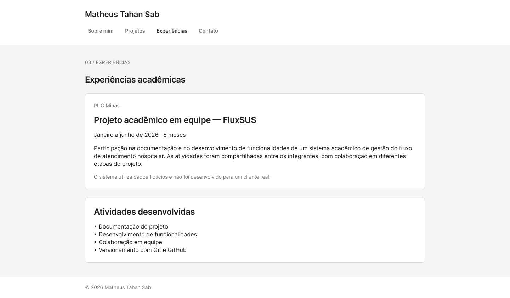
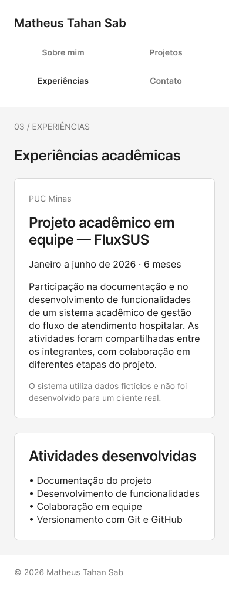
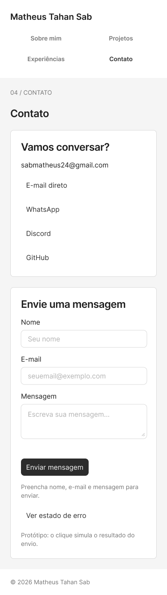

# Protótipos no Figma

[Arquivo editável — Matheus Tahan Sab: protótipos do portfólio](https://www.figma.com/design/zzuu2TrioEYT8kJfKlPSAM)

Wireframes de média fidelidade das quatro seções do portfólio, baseados no conteúdo do repositório. As telas representam visões da mesma página e permitem testar a navegação entre as seções. São uma base para a estilização, sem alteração do site publicado.

## Telas principais

| Seção | Computador — 1440 px | Celular — 390 px |
| --- | --- | --- |
| Sobre mim | [Abrir no Figma](https://www.figma.com/design/zzuu2TrioEYT8kJfKlPSAM?node-id=2-564) | [Abrir no Figma](https://www.figma.com/design/zzuu2TrioEYT8kJfKlPSAM?node-id=2-568) |
| Projetos | [Abrir no Figma](https://www.figma.com/design/zzuu2TrioEYT8kJfKlPSAM?node-id=2-565) | [Abrir no Figma](https://www.figma.com/design/zzuu2TrioEYT8kJfKlPSAM?node-id=2-569) |
| Experiências | [Abrir no Figma](https://www.figma.com/design/zzuu2TrioEYT8kJfKlPSAM?node-id=2-566) | [Abrir no Figma](https://www.figma.com/design/zzuu2TrioEYT8kJfKlPSAM?node-id=2-570) |
| Contato | [Abrir no Figma](https://www.figma.com/design/zzuu2TrioEYT8kJfKlPSAM?node-id=2-567) | [Abrir no Figma](https://www.figma.com/design/zzuu2TrioEYT8kJfKlPSAM?node-id=2-571) |

O arquivo contém **14 telas**: oito telas principais e seis estados complementares (apresentação em inglês, contato com sucesso e contato com erro, para os dois tamanhos).

## Como navegar

1. Abra o arquivo no Figma e escolha o fluxo **Desktop • Navegação do portfólio** ou **Mobile • Navegação do portfólio** na apresentação.
2. Use os itens Sobre mim, Projetos, Experiências e Contato para mudar de seção.
3. Em Sobre mim, clique em **Read in English** para abrir a versão em inglês e em **Ler em português** para voltar.
4. Na tela Contato principal, **Enviar mensagem** abre a simulação de sucesso; **Ver estado de erro** abre a simulação de falha. Os botões **Enviar outra mensagem** e **Tentar novamente** retornam ao formulário principal.

O formulário do protótipo simula a navegação entre estados; ele não envia e-mails. O envio real continua disponível no [site publicado](https://matheus-tahan-sab-portfolio.vercel.app).

## Estrutura e decisões

- Conteúdo em português, com a apresentação pessoal também em inglês.
- Camadas de texto, frames com auto-layout e instâncias de componentes editáveis.
- Controles reutilizados do Simple Design System; cabeçalhos, rodapés e etiquetas locais.
- Tons neutros para concentrar a revisão na hierarquia, no conteúdo e nas interações.
- Tipografia Inter no wireframe, como referência portátil para a fonte genérica `system-ui` usada no site atual. A escolha visual final será definida na estilização.
- O FluxSUS no wireframe tem um espaço reservado e identificado para uma captura real. A implementação atual já tem uma galeria de capturas e outra de wireframes; o Figma documenta a estrutura anterior à inclusão dessas imagens.
- Temas claro e escuro serão detalhados na próxima etapa.

## Capturas exportadas

As cinco capturas abaixo foram exportadas do arquivo Figma. O plano Starter atingiu o limite de chamadas da integração durante as exportações restantes; todas as telas continuam salvas no arquivo editável. Nenhum upgrade foi contratado.

### Computador — Contato

### Computador — Experiências

### Celular

| Sobre mim | Experiências | Contato |
| --- | --- | --- |
|  |  |  |

## Próximos passos

- Aplicar a estilização escolhida com as estruturas fornecidas pelo professor.
- Capturas reais do FluxSUS já publicadas no site e no [README principal](../../README.md); o espaço reservado do wireframe documenta a etapa anterior à galeria.
- Exportar as demais telas quando o limite gratuito da integração permitir, ou pelo editor do Figma.
